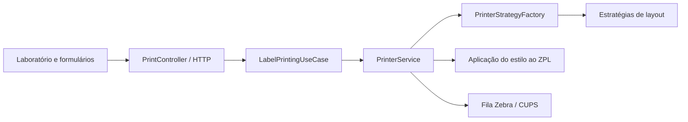

# Preparação para integração com o Granularfood

Este documento registra a fronteira reutilizável de impressão e os contratos disponíveis hoje. A integração com o Granularfood ainda não está conectada.

## Organização atual



`PrintController` depende de `LabelPrintingUseCase`, não da implementação concreta. `PrinterService` implementa essa interface, valida os pedidos, seleciona a estratégia para o módulo e formato, aplica o estilo e envia o ZPL à fila configurada. As estratégias existentes contêm as regras de layout e podem ser reutilizadas sem recriá-las.

## Opções de integração

### Granularfood em outra aplicação ou tecnologia

Usar os endpoints HTTP existentes como contrato de integração. O serviço atual inicia em `127.0.0.1` e porta `8081` por padrão; para comunicação entre máquinas ou contêineres, será necessário configurar uma interface de rede e autenticação antes de expor os endpoints. A checagem de origem do navegador não substitui autenticação entre serviços.

Todos os pedidos usam `Content-Type: application/json`. Endpoints:

| Endpoint | Módulo | Campos principais |
| --- | --- | --- |
| `POST /print` | Simples | `text`, `setor`, `dataFabricacao`, `dataValidade`, `quantity`, `labelType`, `style` |
| `POST /print-validade` | Validade | `productName`, `dataFabricacao`, `dataAbertura`, `dataValidade`, `quantity`, `labelType`, `style` |
| `POST /print-consumo-imediato` | Consumo imediato | `productName`, `dataFabricacao`, `validade`, `quantity`, `labelType`, `style` |
| `POST /print-producao` | Produção | `productName`, `dataPreparacao`, `horarioPreparo`, `horarioDescarte`, `dataValidade`, `quantity`, `labelType`, `style` |

Formatos que a interface atual oferece:

| `labelType` | Papel físico | Geometria do ZPL |
| --- | --- | --- |
| `SINGLE_25X50` | Simples horizontal, 50 × 25 mm | Uma área de 400 × 200 pontos |
| `DOUBLE_25X25` | Dupla, duas etiquetas 25 × 25 mm | Duas áreas por página, separadas pelo espaço do layout |
| `SINGLE_30X50` | Simples horizontal, 50 × 30 mm | Uma área de 400 × 240 pontos |

O campo `style` aceita `fontScale`, `alignment` (`left`, `center`, `right`), `offsetXmm`, `offsetYmm`, `spacing`, `fontFamily` e `border`. Os deslocamentos são aplicados em pontos ZPL por página. O laboratório guarda as opções localmente por módulo e formato; o serviço de impressão recebe a configuração ativa no pedido.

Resposta HTTP `200` significa que o pedido foi enviado à fila, não que a saída física já foi confirmada. Erros de validação retornam `400`; falhas de impressora ou sequência retornam `503`.

### Granularfood e impressão na mesma aplicação Java

O código pode ser consumido como biblioteca Java chamando `LabelPrintingUseCase` com um dos pedidos do pacote `model`. `PrinterService` é a implementação atual e lê nome de fila e caminho da sequência da configuração da aplicação. A interface HTTP pode continuar servindo a tela de laboratório ou ser substituída por uma chamada do sistema maior.

O projeto ainda é empacotado como uma aplicação executável única; a interface cria uma fronteira interna de código, mas ainda não é um artefato de biblioteca publicado. Se o Granularfood também for Java e compartilhar o processo, o passo seguinte será extrair o núcleo (modelos, validação, estratégias e contrato) para um módulo Maven versionado, deixando a aplicação web e o adaptador de impressora como módulos de entrada/saída.

```java
LabelPrintingUseCase printing = new PrinterService();
printing.printLabels(request);
```

Para embutir o serviço dentro do processo do Granularfood, os dois projetos precisam compatibilizar versão de Java, configuração da impressora, sequência de registros e ciclo de vida. Se forem serviços separados, HTTP é a fronteira mais simples; a chamada não deve depender de acesso direto aos arquivos internos de sequência.

## Próximas decisões quando o Granularfood estiver disponível

Antes de conectar produção, confirmar a linguagem e versão de Java do Granularfood, se roda no mesmo host/contêiner, como autentica serviços internos, qual sistema controla a fila Zebra e quem será a fonte dos dados de produto, datas e sequência. Com isso, escolher entre HTTP autenticado ou dependência Java e mapear os campos sem duplicar regras de layout.
